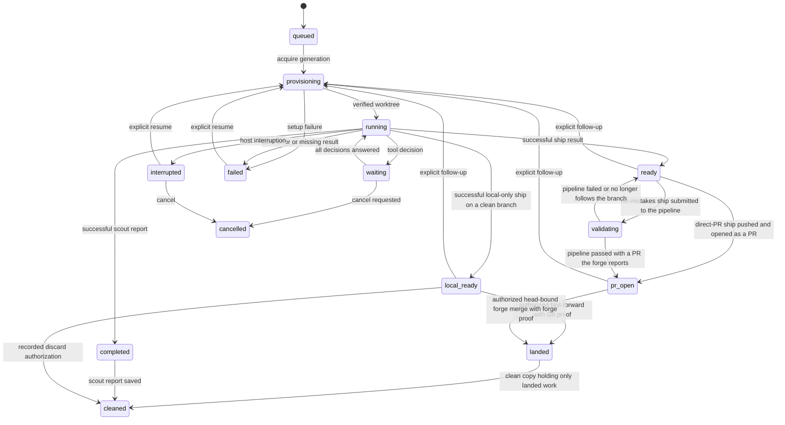

# Firstmate AI architecture

Firstmate AI is a local, single-user supervisor for AI coding tasks.
It runs Claude through the Claude Agent SDK inside isolated Git worktrees, records every task, decision, and message durably in SQLite, and resumes the exact recorded session after interruption.
Effect v4 manages in-process execution and lifecycle; SQLite supplies crash durability.

Two task kinds exist:

- A **ship** changes code in its own worktree under an explicit delivery mode and stops `ready` for human review; a local-only ship stops `local-ready` on a committed branch that an authorized landing fast-forwards onto its target, and a direct-PR ship is pushed and opened as a PR, `pr-open`, that an authorized forge merge lands, and a no-mistakes ship is validated by the no-mistakes pipeline, which opens that PR.
- A **scout** investigates and produces an immutable Markdown report.

## Guarantees

The design is organized around these invariants; every module below exists to uphold one or more of them.

1. Events are append-only history; the task projection, not the latest event, is current state.
2. Unresolved decisions survive unrelated progress and close only when answered or explicitly expired.
3. Unknown liveness never becomes idle, working, or completed without evidence.
4. Each execution attempt carries a generation identity that fences out late writes from earlier attempts.
5. Work happens in isolated worktrees, and no outcome discards unlanded changes without the captain's recorded discard authorization.
6. Exactly one owner controls a task at a time; another process may not silently duplicate execution.
7. Text delivery to a worker and lifecycle control are separate operations.
8. Successful model output, review readiness, publication, and confirmed landing are distinct facts.
9. Delivery mode and merge authority are independent choices.
10. Recovery relies on durable records, never on conversational memory or terminal output.
11. Routine execution and waiting consume no supervisor model calls.
12. Uncertainty about external systems is reported as uncertainty, not replaced with a convenient inferred state.

## Module ownership

| Module | Responsibility |
| --- | --- |
| `src/domain.ts` | Runtime schemas for tasks and their delivery policy, dispatch decision, and PR, efforts, reasoning classes, quota evidence, dispatch candidates, account pins, registered projects and their load validation, intake resolutions, capacity deferrals, pipeline validations, gates and findings, backlog items and their notes, outcomes, and history, holds and their answers, record divergences, backlog settings, decisions, steers, lifecycle controls, wakes (with a subject for wakes about no task), posture sessions and their triaged wakes, memory files and manifests, the home's own event vocabulary, the supervisor record, merge approvals, forge merges, local and forge landing proof, and events, the flat stored task record and its translation, the event type and data vocabulary, tagged application errors, legal state transitions |
| `src/store.ts` | SQLite transactions, task projections, event history, process leases and their activity evidence, generation checks, approval, steering, and lifecycle control records, steering reconciliation evidence, the home's supervisor lease, the classifier cursor, the wake queue and its consumer generations, merge approvals and flags, forge merges, the delivery lease and the PR and landing records it writes, the validation records, gate responses, and holds a validation writes under that lease, the captain's hold answers, the backlog with its dispatch, completion, hold, answer, attestation, retention, and divergence transitions, each committed with the task change that causes it, the project registry and its history, the capacity check made when an attempt takes its lease, the secondmate registry and its history with the launch and exit records of its relaunch policy, correlated requests and their mirrored replies, backlog handoffs and their placement and restoration, a home's secondmate identity, inbox and published status, the shared preferences, and account pins, posture sessions with the triage of each captain wake fenced by the supervisor lease, stow's notes and record, and the home's posture, memory, and stow history, the ledger of extension records it exposes, the Effect `TaskStore` service, its generation-bound `Attempt` and `Supervision` handles, and the per-task change feed that alone detects changes committed by other connections |
| `src/migrations.ts` | The ordered schema migration list, each step applied in its own transaction and recorded in `user_version`, a step that rebuilds a referenced table run with foreign-key enforcement off and checked before commit; refusal of databases newer than the code |
| `src/ledger.ts` | The schemas and SQL of the integrations and events records: process sources and captured results, inbox notes and replies, the Relay settings, mentions, and promised final replies, upstream links and signals, and outbox actions, each mutation committed with the wakes it delivers and, on the supervisor's side, fenced by its generation |
| `src/extensions.ts` | The extension registry and its built-in extensions (process sources, the captain inbox, Relay, upstream signals, and the outbox), the process runner for sources, the deterministic triage of upstream observations, and sending an outbox action through the extension that owns its channel |
| `src/relay.ts` | The Relay adapter interface (poll mentions after a cursor, reply under an idempotency key, dismiss) and its HTTP implementation |
| `src/secondmates.ts` | The secondmate transport adapter and its local implementation, creating, launching, stopping, and retiring secondmates, the routing decision, handoffs and their recovery, requests and reading their replies, pushing shared preferences, the relaunch policy's review, and a secondmate home's service of its inbox |
| `src/posture.ts` | The posture triage policy for captain wakes, entering and leaving away and quiet, the return brief built from durable records and its text rendering, and stow |
| `src/memory.ts` | The home's memory files and the shared preferences as memory: reading, appending and replacing them, and composing the bounded memory section of a worker's context with its manifest |
| `src/backlog.ts` | Dispatching a backlog item through task intake, a completed scout's captain-call attestation, and the listed view of an item with why it waits and its open captain call |
| `src/projects.ts` | Project registration and updates checked against the clone, posture resolution, and intake resolution of a task's project, base, branch prefix, and delivery policy |
| `src/worktrees.ts` | Argument-array Git invocation, immutable base and target branch resolution, isolated worktree creation and identity verification, the branch head an attempt ends at |
| `src/runtime.ts` | The worker runtime adapter interface (open a session with streaming input and a normalized event stream, interrupt through its abort controller, read a transcript, check a pinned account), the runtimes Firstmate knows by name, and the `Runtimes` service that registers only verified adapters and refuses every other runtime |
| `src/agent.ts` | The Claude runtime, the reference adapter: SDK options, the system prompt with the home's memory, tool surface, permission hooks, model, effort, and account-pin environment, normalization of SDK messages into runtime events, and the `claude auth status` account check |
| `src/dispatch.ts` | The home's `dispatch.json` and its load validation, the quota provider interface and its `quota-axi`, saved-file, and disabled sources, and dispatch resolution: precedence, profile-array selection from one quota snapshot with per-candidate evidence, the effort fallback, and account-pin refusals |
| `src/interpreter.ts` | Pure interpretation of runtime event frames into steering, session, transcript, and result effects, and the final result verdict |
| `src/orchestrator.ts` | Effect execution scopes, queue concurrency, task intake with its dispatch decision, task attempts on the task's verified runtime after its account-pin check with the home's memory loaded and recorded, consuming the change feed for cancellation, lifecycle control, approval waiting, and steering delivery, streaming input, recording runtime activity, applying interpreted effects, the steering settle bound, session resume |
| `src/classifier.ts` | Pure classification of events into actionable wakes |
| `src/authority.ts` | The one pure merge-authority evaluation: captain approval or yolo, flags, required checks, and named waivers |
| `src/delivery.ts` | Delivery under the task's lease: publishing a direct-PR ship as a PR, reading its current head and checks, and landing either by the guarded local fast-forward with Git proof or by a head-bound forge merge with forge proof, each after the authority evaluation |
| `src/validation.ts` | The process runner, the validation adapter interface and its no-mistakes implementation, which runs `no-mistakes axi` with argument arrays and reads its TOON output, the host's finding policy, and the validation driver |
| `src/forge.ts` | The forge adapter interface (locate a repository, open PR, find the open PR between two branches, read PR state and head, read the checks a head must pass, merge bound to a head, read landing proof, observe an issue or PR's state, comments, and reviews after a baseline, and comment under an idempotency marker) and its GitHub implementation, which runs `gh api` with argument arrays |
| `src/supervisor.ts` | The persistent supervisor: home lease, event classification through the cursor, lease review for stale and orphaned attempts, the recovery ladder, relaunch and resume, queued execution within its bound and each project's capacity, driving no-mistakes validations, the forge review that merges authorized yolo PRs, the main home's review of its secondmates, a secondmate home's service of its routed work, posture-aware reporting of captain wakes, opening every registered extension and reviewing it each tick, and clean shutdown |
| `src/cli.ts` | npm executable, user commands including the supervisor, project, backlog, secondmate, preferences, dispatch, account, posture, memory, source, inbox, relay, upstream, and outbox groups, extensions, stow, the return from away on a captain action, and approve, flag, publish, validate, validations, holds, answer-hold, checks, and land, JSON output and process signals |
| `src/index.ts` | Public package exports |

Effect v4 `Context.Service` and `Layer` define the storage, worktree, worker runtime, quota provider, forge, validation pipeline, process runner, secondmate transport, Relay, and extension registry dependencies.
`Effect.acquireRelease` scopes database handles, per-task ownership, signal listeners, and SDK queries.
`TaskStore.changes` gives each attempt one scoped change feed, a `Stream` that polls SQLite every `pollMs` and is shared by every subscriber until the attempt's scope closes.
The cancellation and control observer and the steering pump are `Effect.forkScoped` subscribers, each approval wait subscribes until it has an answer, and `Effect.forEach` bounds concurrent task execution in `run-all`.
The supervisor forks each attempt into a scoped `FiberSet` and counts the attempts it runs against its own bound.
Expected failures enter the typed error channel as tagged errors from `domain.ts`, such as `StaleGeneration`, `LiveOwner`, `InvalidTransition`, `MergeRefused`, `NotFound`, `TaskCancelled`, and `RunInterrupted`, with `AppError` for untagged I/O, Git, and SDK failures.
Execution exits are persisted before reporting failure.
Effect provides in-process lifecycle management only.
No claim of durable Effect fibers or exactly-once external execution is made.

## State and events



The transition table in `domain.ts` is authoritative; the diagram summarizes common paths, and `local_ready` and `pr_open` stand for the states `local-ready` and `pr-open`.
A `validating` task cannot start an attempt, because the pipeline owns its branch.
A `landed` task's only transition is to `cleaned`; follow-up work is a new task.
Every stopped state may become `cleaned` under a recorded discard authorization, and a `cleaned` task has no further transitions.

A task has three parts beside its `id` and `createdAt`.
`intake` holds what the task was asked to do: kind, prompt, project clone, the registered project's name when it has one, base commit, branch, worktree, model, and limits.
A ship's isolated copy is created from its target branch's head at that moment when that head contains the recorded base, so a ship queued before a landing starts from the landed code; otherwise, and for a scout, from the base.
`worktree.ready` records the commit a copy started from when the attempt created it.
`run` holds the latest attempt's runtime record: state, generation, session, cost, output, error, cancellation, and `updatedAt`.
`policy` holds a ship's delivery mode, merge posture (`yolo`), target branch, and, when it decided the mode, its declared surface, resolved at intake and never rewritten; scouts, and ships created before delivery modes, have none.
`run` also records `commit`, the ship's branch head when its latest result was recorded, and, for a direct-PR ship or a validated no-mistakes ship, `pr`: the PR's URL, number, head, and target exactly as the forge returned them, kept across later attempts so they update that PR.
A passed validation replaces `commit` with the PR's head, which includes any pipeline fix commits, because that is the commit merge authority binds to.
After creation the store writes only `run` fields, and an attempt update that names any other field is refused.
SQLite and CLI JSON keep the original flat task record; `domain.ts` translates between it and the nested shape when the store reads and writes and when the CLI prints.
Task projections and their corresponding events commit in the same SQLite transaction.
Each event type in the vocabulary in `domain.ts` has a data schema that is checked on write and decoded on read; a type outside the vocabulary is returned with its data as recorded.
WAL mode, full synchronization, and a busy timeout permit readers and short writes from multiple local CLI processes.
Opening a home applies only the migration steps its `user_version` lacks, each in a write transaction that re-reads the version so concurrent openers apply a step once; a failed step rolls back and leaves the version unchanged, and a database newer than the code refuses to open.
The event cursor is a monotonically increasing SQLite sequence, and reads return up to 1,000 events after the requested sequence.
Reading events never acknowledges them: the supervisor's classifier is the one event consumer, and its durable cursor advances only in the transaction that records the wakes it classified, as [Supervision](#supervision) describes.

## Ownership and recovery

Each active attempt owns a random generation token and a lease containing its host and process ID.
The orchestrator writes only through the scoped `Attempt` handle that acquisition returns, and closing that scope releases the lease.
Mutations verify both the lease token and the task generation.
A living owner blocks another execution; an unknown or foreign owner also blocks recovery.
Explicit resume may reclaim a locally proven dead owner and expires pending decisions from the previous generation.
PID reuse conservatively blocks recovery rather than allowing duplicate execution.
Homes shared over network filesystems or between hosts are unsupported.

Process liveness is only an ownership observation.
It is not evidence that a model or tool is making progress; that evidence is the SDK activity each attempt records on its lease, which the supervisor reads.

## Isolation and Git

Task intake resolves a local ref to a commit and records the source root, worktree path, and generated task branch.
Worktree preparation is durable-first: the task and attempt exist before Git is invoked.
Existing worktrees are reused only after root, branch, common Git directory, and base ancestry checks pass.
A branch left without its worktree after an interrupted Git operation causes refusal; it is never force-reset or deleted.
The orchestrator never switches, resets, stashes, fetches, or merges the source checkout, and never removes worktrees.
The one write to the source checkout is an authorized local-only landing's fast-forward of its checked-out target branch, and the one push from it is publishing a direct-PR ship's ready commit to its own task branch on `origin`, both described in [Delivery and merge authority](#delivery-and-merge-authority).
A no-mistakes ship's pushes are the pipeline's own, made from its own checkout; Firstmate runs `no-mistakes axi` in the task worktree and never pushes that branch itself.
All Git arguments are passed directly to the executable without a shell.

Worktrees share a repository's Git metadata and are not a security sandbox.
Claude's file writes have path and symlink checks, and shell execution requires a durable human decision.
Approved shell commands retain the user's full operating-system authority.
Prompt instructions about delivery are additional guidance, not a substitute for an OS sandbox.

## Claude integration

The Claude runtime is the reference implementation of the worker runtime adapter described under [Dispatch](#dispatch).
The adapter uses the documented TypeScript `query()` interface.
`settingSources: []`, explicit `permissionMode: "default"`, an explicit tool set, and mutation hooks keep project settings from silently granting approval.
Scouts receive read tools and questions; ships additionally receive file editing and command tools.
`canUseTool` persists the exact request and waits for an answer or cancellation.
The answer is recorded before permission is returned to the SDK.
`AskUserQuestion` answers are passed back through the documented `answers` field.
Answers are scoped to one request and one generation and do not install future permission rules.

The first SDK session ID is persisted as soon as it appears.
Resume passes that exact ID and rejects a different returned session ID.
Assistant text, tool identities, result status, and estimated session cost become durable events.
The SDK's result can report an error even when iteration itself succeeds, and some failures throw after yielding their result; both paths remain failures, with available usage retained.
A stream ending without a result is unverified failure.
For the pinned SDK, a resumed result includes earlier session spend, so the latest cumulative value replaces the previous estimate rather than being added twice.
The task's dispatched model and effort become the SDK's `model` and `effort` options; a task created before dispatch passes neither, so it keeps the SDK's defaults.

## Durable steering

Steering lets the user send text to a running or resumable task without losing it to a crash or a closed session.
The payload is durable from the moment it is enqueued, and only evidence from the SDK advances it.

`firstmate steer` writes a steering record in one transaction with its event.
Its `id` is both the record identity and the SDK user-message UUID, and its per-task `sequence` is never reused because records are never deleted.
Steering is text only; cancellation and other lifecycle actions never travel through it.

A run opens the SDK with streaming input instead of a single string prompt.
A scoped loop claims pending records in sequence order, moves them to `submitted` under the run's generation, and writes them to the input stream.
Claims and every later transition are generation-fenced, so an old attempt cannot move a newer attempt's records.

Status changes only on evidence:

| Status | Evidence |
| --- | --- |
| `pending` | Durably enqueued, or proven safe to resend |
| `submitted` | Written to a generation's input stream; receipt unproven |
| `delivered` | The CLI echoed the message (`--replay-user-messages`), or the session transcript holds its UUID |
| `acknowledged` | An assistant reply stamped `user_message_uuid` with this message, with a later message of the same generation, or with a resume prompt that named it |
| `uncertain` | An ended generation left it unconfirmed and the transcript could not be read |

Steers share one priority, so the CLI consumes them in order; a stamp on a later steer therefore proves earlier ones were consumed, which covers coalesced batches.
Enqueueing or submitting never acknowledges a message.

The input stream stays open after a result until `closeInput` proves, in one transaction, that nothing is pending and nothing this generation submitted is unacknowledged.
A steer enqueued after that close stays pending for the next explicit run or resume.
Completion to `ready` or `completed` is refused while this generation has unacknowledged steering.
If a result arrives with steering still unacknowledged and the session then stays idle beyond the settle bound (default 120 seconds), the run records the unacknowledged steers in a `steer.unsettled` event and aborts as `interrupted`, leaving resume to reconcile.
A failed result closes the input immediately.

Resume reconciles every record an earlier generation left `submitted` or `delivered` before opening the SDK:

- Transcript holds its UUID: `delivered`; the resume prompt names it by sequence, and a stamp on that prompt acknowledges it.
- Transcript readable but lacks it, or no session was ever recorded: `pending`, resent with the same identity.
- Transcript unavailable (the SDK returns no messages for a missing session, which proves nothing): `uncertain`, never resent automatically.

`firstmate requeue <steer-id>` is the explicit consent to resend an uncertain message despite a possible duplicate.
The pinned CLI's echo, reply stamp, and transcript identity were verified live; see [verification](verification.md).

## Supervision

`firstmate supervisor start` runs one long-lived supervisor for a home until Ctrl+C, a termination signal, or `firstmate supervisor stop`.
It owns queued execution, turns actionable events into durable wakes, and recovers stalled attempts on a bounded ladder.

### Home lease

The supervisor holds a home-level lease in SQLite carrying its host, PID, and a random generation, like a task lease.
A live owner refuses a second supervisor, and an owner on another host or with unreadable liveness refuses as unknown.
A lease left by a process proven dead on this host is replaced, and the new supervisor reports the generation it reclaimed; PID reuse conservatively refuses.
While a live supervisor holds the home, first runs through `run` and `run-all` are refused because it owns queued execution; explicit `resume` stays available.
The lease is released when the supervisor's scope closes.

### Waiting without model calls

Each review, every poll interval (default one second), classifies new events, reviews attempt leases, handles the supervisor's own wakes, and starts queued tasks while fewer than its concurrency bound (default 2) of its attempts run and their project has a place, as [Capacity](#capacity) describes.
Waiting is a timer and SQLite reads; the only model calls are the task attempts themselves, so an idle fleet costs nothing.

### Classification and the wake queue

`classifier.ts` maps one event to at most one wake without performing anything:

| Event | Wake | Consumer |
| --- | --- | --- |
| `task.result` | `finished` | captain |
| `run.stopped` with state `failed` | `failed` | captain |
| `decision.requested` | `decision` | captain |
| `steer.uncertain`, `steer.unsettled` | `steer` | captain |
| `recovery.exhausted` | `escalated` | captain |
| `pr.opened` | `published` | captain |
| `pr.failed`, `validation.failed` | `failed` | captain |
| `hold.opened` | `hold` | captain |
| `task.landed` with basis `yolo` | `landed` | captain |
| `clone.refused` | `refresh` | captain |
| `control.applied` for a relaunch | `relaunch` | supervisor |

Progress, text, tool use, and the host's own bookkeeping raise nothing, so an unchanged fleet is never reported as progress.
The classifier's cursor starts after the history that existed when the home was upgraded to supervision, and each batch of wakes commits in one transaction with the cursor move, refused if the cursor moved meanwhile, so no event is classified twice or skipped.
Reviews add condition wakes for the supervisor: `stale` and `orphaned` for attempts, and `resume` for attempts a stopping supervisor interrupted.

Every wake has a key that makes recording it idempotent; a key is never recorded twice, even after acknowledgement.
A consumer claims its open wakes under a queue generation, and only that generation's acknowledgement retires them.
The captain's generation is new on each `supervisor wakes` presentation, which re-claims every open captain wake, so an acknowledgement from an earlier presentation is refused rather than retiring wakes it never showed.
The supervisor consumer's generation is its lease, so a replaced supervisor's late acknowledgement fails and the wakes it claimed but never acknowledged go to its successor.
Extensions add captain wakes about no task, each naming the extension record it is about as its `subject` (see [Integrations and events](#integrations-and-events)): `source-result` and `source-down`, `note`, `mention`, `followup` (whose task is the promise's), `upstream`, and `outbox`.
Handling that record acknowledges its open wakes, as `supervisor ack` would.
The supervisor acknowledges each wake only once it is handled; a handler that cannot finish yet leaves it claimed for the next review, and every handler rechecks the task's generation and state, so handling a wake again after a crash repeats no task action; at worst an orphan's recovery is counted twice, which only shortens its ladder.

### Liveness

Each SDK message an attempt reads is liveness evidence, written to its lease at most once per activity interval (one second, or a quarter of the silence bound for the supervisor's attempts) without appending an event.
An attempt's silence runs from the later of its last recorded activity and its task's last state change, so time spent waiting on a decision never counts.
A running attempt silent for the bound (default 600 seconds, `--stale-after`) raises one `stale` wake for its generation, whichever local process owns it.
An active task whose owner is proven dead raises one `orphaned` wake; an owner whose liveness is unknown raises nothing.

### Recovery ladder

The recovery count is the number of `recovery.attempted` events since the task's last successful result, which resets it.
For a stale attempt the supervisor records the next attempt and, in the same transaction, a relaunch control; the owner stops, and the resulting `relaunch` wake resumes the exact session with a prompt naming the recovery.
For an orphaned attempt it records the attempt and resumes the exact session directly.
Once the configured number of recoveries (default 2, `--recoveries`) is recorded, the next stall records `recovery.exhausted` instead, interrupting a live attempt, and the captain receives an `escalated` wake; nothing recovers that task automatically until it produces a successful result.
A failed attempt is reported to the captain and never retried automatically.

### Lifecycle control

`firstmate interrupt` and `firstmate relaunch` write a control record addressed to the task's current generation, separate from steering text; they refuse when no live owner runs it.
The owning attempt sees the request on its change feed, aborts, and applies the control in the same transaction that records it stopped as `interrupted`.
A relaunch is resumed by the live supervisor, or by the next one to start, with the request's optional prompt.
A request the generation ends without applying expires, and no control ever signals a process.
Cancelling an interrupted task keeps a supervisor from resuming it.

### Stopping and restarting

On a signal or a stop request the supervisor records a `resume` wake for each attempt it is running, aborts them so they stop as `interrupted` with their sessions and worktrees intact, and releases its lease.
The next supervisor resumes those exact sessions without counting a recovery, so a restart is not an event for the task.
A supervisor that crashes leaves its lease and its attempts' leases behind; its successor reclaims the home lease only after proving the PID dead, and its review finds the attempts orphaned.
Proven dead means the owning Firstmate process: the Claude Code process it spawned for an attempt is not recorded in the lease and can outlive an owner that died abruptly.
Such a process cannot run a mutating tool, because approval goes through its dead parent, but until it exits it can still read files and write to the session the resumed attempt uses.

`firstmate supervisor status` prints the lease record and its observed owner, settings, last review and error, the classifier cursor beside the latest event, open wakes per consumer, the tasks the supervisor owns, and each task's recovery count.

## Delivery and merge authority

### Delivery mode and merge posture

Ship intake resolves a delivery mode and a yolo setting, as [Projects](#projects) describes, and records both on the task with its target branch; a scout given either is refused.
The target is `--target`, else `--base` when it names a local branch, else the registered project's default branch, else, for an unregistered project, the branch checked out in the project when the base is its `HEAD`; anything else is refused.

| Mode | Where a successful attempt stops |
| --- | --- |
| `no-mistakes` | `ready`, then `validating` once submitted to the pipeline and `pr-open` once it passes, as [Validation](#validation) describes |
| `direct-PR` | `ready`, only when the worktree is clean, then `pr-open` once published, as [Forge delivery](#forge-delivery) describes |
| `local-only` | `local-ready`, only when the worktree is clean |

A ship that must stop clean but leaves uncommitted changes fails instead and stays resumable.

Every ship result records its branch head as `run.commit` and in its `task.result` event.
Yolo is merge posture only and never changes how work runs.

### Merge authority

`authority.ts` evaluates merge authority in one place, and every merge path asks it before merging and records the basis it returns.

- Authority is the captain's approval of the exact head being merged, or yolo.
- A flag (destructive, irreversible, or security-sensitive) requires an approval recorded after it; yolo cannot authorize a flagged merge.
- Each required check must be green on that head; one that is red, pending, or reported for another head is refused unless the approval relied on names it as a waiver.

Its input is the posture, the head, the task's approvals and flags with their event sequences, and the required checks.
Local-only delivery has no forge and passes no checks; for a PR the forge adapter supplies them, read for the PR's current head only.
`firstmate approve` appends a `merge.approved` event naming the ready commit and any waivers, refused unless the task is `local-ready` or `pr-open`, so a later ready commit needs a new approval.
`firstmate flag` appends `merge.flagged`; no command clears a flag.

### Local-only landing

`firstmate land` takes the task's lease for the landing, so no attempt can start and move the branch, and evaluates authority under it.
It then fast-forwards the target in the project clone with argument-array Git, refusing when:

- The task branch no longer points at the ready commit.
- The clone has another branch or a detached `HEAD` checked out.
- The clone has uncommitted or untracked changes.
- The target has diverged from the ready commit.

The task becomes `landed` only when `merge-base --is-ancestor` shows the ready commit on the target afterwards, in the transaction that appends `task.landed` with the target's commits before and after, whether a fast-forward was needed, the authority basis, the approval's sequence, and any waived checks.
A refusal changes nothing, and the task stays `local-ready`.

### Forge delivery

`forge.ts` defines the forge adapter, and every forge read and write in delivery goes through it.
The GitHub implementation identifies the repository from the project clone's `origin` remote URL and calls `gh api` with argument arrays; `applicationLayer` accepts another implementation, as tests and later forges provide.

Publishing runs under the task's lease once a direct-PR attempt ends `ready`, after the attempt has released the task, and `firstmate publish` retries it.

- It pushes the exact ready commit to the task branch on `origin` with a lease on the head the task last published, absent before the first push, so a commit someone else pushed is never overwritten.
- It opens a PR from the task branch into the target, or takes the PR the forge already has open between them, or updates the task's own open PR.
- The PR's URL, number, head, and target are recorded only from the forge's response, re-read for a bounded time until the forge reports the pushed commit as the head; a different head or target is refused.
- Success moves the task to `pr-open` with `pr.opened` or `pr.updated`; a failure appends `pr.failed` and leaves the task `ready`.

The checks a merge must pass are every check the target's branch protection and rulesets require, `unreported` when it has no result for the head, and every other check reported for the head; only the latest run of a check counts, and results for any other commit are never read.
`firstmate checks` prints the PR as the forge reports it, these checks, and the current verdict without merging.

`firstmate land` on a `pr-open` ship takes the task's lease and reads the PR from the forge.
It refuses a closed PR, a head other than the ready commit, and a base other than the target, then evaluates merge authority over the forge's checks and merges through the forge bound to that head, so a head that moves after the evaluation makes the forge refuse.
The forge's acceptance is recorded as `pr.merged` with the merge commit and authority basis before landing is proven.
The task becomes `landed` only when the forge shows the merge commit on the target, in the transaction that appends `task.landed` with the PR, merge commit, the target's head, the basis, the approval's sequence, and any waived checks.
Unproven landing leaves the task `pr-open`, and a later `land` re-reads the proof without merging again; a PR merged outside Firstmate at the ready commit lands with basis `external`.

The supervisor's forge review, every `--forge-every` seconds, tries to land each `pr-open` yolo ship it is not running.
An autonomous merge's `task.landed` becomes a captain `landed` wake whose one line carries the full PR URL.
A refusal that is not waiting on a pending or unreported check becomes one `escalated` wake per ready commit, so a red check or a flag reaches the captain while a PR still waiting on CI stays quiet.

### Validation

`validation.ts` defines the validation adapter, and every pipeline command validation performs goes through it.
The no-mistakes implementation runs `no-mistakes axi run`, `status`, and `respond` in the task worktree through the process runner, which passes argument arrays and never a shell, and reads their TOON output into a normalized report; `applicationLayer` accepts another pipeline or process runner, as tests do.
The pipeline owns review, fixes, tests, documentation, push, PR, and CI; Firstmate adds no review gate of its own, and the worker is never asked about the pipeline.
The project clone must already be initialized with `no-mistakes init`, and the pipeline's daemon is shared infrastructure that Firstmate never starts, stops, or updates.

`firstmate validate` drives one validation under the task's lease, so no attempt can start meanwhile.

- On a `ready` ship it records a validation, moves the task to `validating` with `validation.started`, and starts a run with the task prompt as the pipeline's intent; a worktree that is dirty or has moved from the ready commit is recorded as a failed validation instead, because the pipeline validates committed history only.
- On a `validating` ship it reads the recorded run and reattaches to it.
- Each axi call drives the run for at most five minutes; a call that returns because that wait elapsed is not a failure, and the driver reads the run's status and reattaches.
- The pipeline's run identity is recorded with `validation.run`, and every gate it raises is recorded once with `validation.gate`, numbered by its occurrence in that run's step, with each finding as the pipeline wrote it.

Each gate is decided by the host's finding policy, `decideGate`, or held for the captain.

- A gate with any finding the pipeline classifies other than `auto-fix` or `no-op` (an `ask-user` finding, a refusal, or a classification Firstmate does not know) is held.
- A gate whose `auto-fix` findings the policy has already fixed twice in that step of the run is held.
- Otherwise the policy fixes the `auto-fix` findings, or approves a gate with only `no-op` findings or none.

A held gate opens a hold, an open question that only the captain closes: `hold.opened` carries the question, which quotes every finding as the pipeline wrote it, and the captain receives a `hold` wake.
Driving stops there, and the pipeline stays parked.
`firstmate answer-hold` closes the hold with `hold.answered`, storing the captain's text verbatim with the action (`approve`, `fix`, or `skip`) and, for a fix, the findings it names.
The next `validate` carries the answer out on that same gate: a fix passes the text as the pipeline's instructions, and an approval of the Test step passes it as the recorded exception reason.
Every response is recorded with `validation.responded`, naming whether policy or the captain decided and which hold it carries out, before it is sent, so a crash between the two never applies an answer to a later gate; a gate seen again after such a crash is decided or held again.
An answer whose gate's findings no longer match is not carried out.

A passing outcome (`checks-passed`, `passed`, `passed-with-override`, or `passed-with-skips`) is not proof of a PR: the driver finds the open PR from the task branch into the target through the forge adapter, re-read for a bounded time, and refuses one whose URL differs from the pipeline's report.
`validation.passed` and `pr.opened` then record the forge's PR, and the task moves to `pr-open` with that PR's head as its commit.
From there merging is a direct-PR ship's: `checks`, `approve`, `land`, and the supervisor's yolo review use the same forge reads and the one authority evaluation.
A `failed` or `cancelled` outcome, a passing outcome without a matching PR, a pipeline that refuses to start a run (such as in a clone never initialized with `no-mistakes init`), or a pipeline that no longer has a run for the branch records `validation.failed` and returns the task to `ready`, and the captain receives a `failed` wake; `validate` then starts a new run.
An error reading a run the pipeline did start, or repeated quick errors, stops driving without changing the task, so a later `validate` retries.
`firstmate validations` prints a task's validation records and `firstmate holds` the open holds.

The supervisor drives a validation for each no-mistakes ship whose ready commit has none, and for each validating ship with no open hold and no live owner, so an answered hold is carried out without a command; it does not count validations against its attempt bound, and a validation it could not drive waits `--forge-every` seconds before another try.

### Clone refresh

After a forge landing is proven, `refreshClone` brings the project clone's local target up to `origin`'s, so tasks created or started afterwards begin from current code.
It fetches the target into its remote-tracking ref with argument-array Git and moves the local target only by a fast-forward: `merge --ff-only` when the clone has it checked out, and otherwise a compare-and-swap `update-ref` against the head it read.
It refuses a clone with uncommitted or untracked changes and a local target with commits the remote's lacks, never resetting, merging, rebasing, or stashing, and it succeeds only when the merge commit is on the local target afterwards.
The landing is already proven, so the outcome is recorded rather than raised: `clone.refreshed` with the target's commits before and after, or `clone.refused` with the reason, which becomes a captain `refresh` wake.
`firstmate refresh` retries it for a forge-landed ship.
A local-only landing needs no refresh, because its guarded fast-forward already moved the clone's target.

### Cleanup

`firstmate cleanup` removes a task's isolated copy and branch and moves it to `cleaned` with `task.cleaned`, which records the basis, the authorization relied on, the removed branch head, and which parts were present.
It takes the task's lease, so no attempt or delivery can start meanwhile, and refuses a task whose state cannot become `cleaned`, such as a running or validating one.
A copy that exists but cannot be proven to be the task branch's worktree of the project, or whose checkout is not the branch head, is refused rather than removed.
The basis is decided in `cleanup.ts`, in this order:

- Any open hold on the task's pipeline gate refuses, even under a discard authorization, because cleanup never retires the captain's question.
- Any open promised final reply bound to the task refuses, even under a discard authorization, until its final reply is sent or the captain releases it (see [Relay](#relay)).
- A `completed` scout whose report is saved has basis `report` once `backlog complete` has attested its captain calls (see [Backlog and holds](#backlog-and-holds)) and every attested item is still held or answered: its copy is scratch and is removed even when dirty.
- A `landed` ship has basis `landed` only when its copy has no uncommitted or untracked changes and its branch head is the landed commit or an ancestor of it.
- Anything else needs a `discard.authorized` event recorded by `firstmate discard` since the task's last attempt started, naming the branch head as it is now; a branch that moved since needs a new authorization.

Without a discard basis the copy is removed with `git worktree remove` without force, so Git also refuses a dirty copy; the branch is deleted with a compare-and-swap `update-ref -d` against the inspected head.
A copy or branch already absent, as after an interrupted cleanup, is not an error.
Every refusal appends `cleanup.refused` with its reason, and there is no force flag.
The task record, its events, and scout reports remain after cleanup.

## Projects

### Registry

The project registry is the home's configuration, stored in the `projects` table with one JSON record per project, and every change appends `project.added`, `project.updated`, or `project.removed` to `project_events` in the same transaction.
A record has these fields, and `ProjectSchema` in `domain.ts` is authoritative:

| Field | Meaning |
| --- | --- |
| `name` | 1-64 letters, digits, dots, underscores, dashes, or inner spaces, so it is never a path on any OS |
| `clone` | The clone's repository root, an absolute path in the host's native form; one clone registers once |
| `defaultBranch` | The local branch tasks start from and land on unless a task names its own |
| `delivery` | `no-mistakes`, `direct-PR`, `local-only`, or the conditional `no-mistakes-prod-only` |
| `yolo` | The standing merge posture |
| `branchPrefix` | Prepended to a task ID to name its branch; `firstmate/` by default and may be empty |
| `capacity` | Most attempts running at once for the project, a positive integer, or `null` for uncapped |
| `forge` | `github`, or `null` exactly when the posture is `local-only`, which publishes nothing |
| `createdAt`, `updatedAt` | ISO timestamps |

Every read decodes the record with its schema and value rules, reporting every shape error at once, and a record that fails is reported with the project's name, what is wrong, and the `project update` and `project remove` commands that fix it.
Nothing that needs a malformed record proceeds: intake, `project show`, an attempt's capacity check, and the supervisor's start of that project's tasks all refuse, `project list` prints the error in the entry's place and exits nonzero, and intake by path refuses when a malformed record may be that clone's.
`project update` merges the given settings into the stored fields even when they are malformed, and saves only a valid result.
Registration and updates also check the clone with argument-array Git: the default branch must exist locally, the prefix must form a valid branch name, and a publishing posture needs an `origin` remote.
Paths are stored as the host resolves them and timestamps as ISO strings, so the record is the same on Windows, macOS, and Linux.

`project remove` unregisters a project without touching its clone, refused while any of its tasks holds unlanded work: any task that is not a landed ship, a completed scout, or cleaned.

### Intake resolution

`add --project` names a registered project, or else a repository root, which uses the registration of that clone if one exists.
The base is `--base`, else the project's default branch, else `HEAD`; the branch is the project's prefix, or `firstmate/`, followed by the task ID.
A ship's delivery mode and yolo are resolved by `resolvePosture` in `projects.ts`:

- An explicit `--delivery` or `--yolo` wins.
- Otherwise a flat registered posture and the registered yolo apply.
- On a `no-mistakes-prod-only` project the ship must declare its surface; `internal-only` resolves to `direct-PR`, and `product-facing`, `mixed`, and `uncertain` to `no-mistakes`, recorded on the task as `policy.surface`. The surface is never inferred from paths or names, an undeclared one is refused, and a surface given where it decides nothing is refused.
- An unregistered project resolves to `no-mistakes` with yolo off.

`intake.resolved`, committed with `task.created`, records the project and how it matched, the posture, where each choice came from, the surface, and for an unregistered project the gap, which `add` also prints to stderr.
Creation is refused if the project changed between resolution and the write.
Updating a project never rewrites an existing task.

### Capacity

A project's places are held by its tasks in an active state (`provisioning`, `running`, or `waiting`), whichever local process owns them and whether or not that owner still lives, so an orphan holds its place until recovered.
Taking an attempt's lease counts the other holders in the same write transaction and refuses with `AtCapacity` when the project is full, leaving the task unchanged, so two processes never both take the last place.
The supervisor checks first, also counting attempts it has forked that have not taken their lease, and leaves a queued task beyond capacity queued, recording one `task.deferred` naming the holders, then starts it on a later review once a place frees; a resume or relaunch it owes waits the same way.
`run-all` bounds each capped project's tasks among its own runs, and a foreground `run` beyond capacity is refused.
Validations and other delivery work hold no place, because no worker runs.

## Backlog and holds

### Items

The backlog is a list of items held apart from tasks in the home's store (`items`, with `item_events` as their history): an idea queued before dispatch is not a task.
An item has an id (a slug of its title unless given), a title, a kind (`ship`, `scout`, or `captain`), an optional project and prompt, a status (`queued`, `in-flight`, `held`, or `done`), the items it depends on, an optional defer date, notes, the task dispatched from it, its open hold, and the outcome that closed it.
`backlog add`, `update`, and `remove` change only description, dependencies, deferral, and notes; a dependency must exist and never make a cycle, and an item that is in flight, held, or depended on by an item not done cannot be removed.
Status changes only through the transitions below.

### Dispatch and completion

`backlog dispatch` creates the item's task through the same intake as `add`, and `Store.create` moves the item to `in-flight` with the task's id in the transaction that inserts the task, appending `item.dispatched` to the item and `item.linked` to the task.
It is refused, before and again inside that transaction, for a captain item, an item not `queued`, an item whose dependency is not `done` (an archived item counts as done), and an item whose defer date is ahead.
A ship's landing (`finishLanding`) closes its item as `landed`, a scout's attestation closes its item as `report`, and cleanup (`finishCleanup`) closes an item still open as `landed`, `report`, or `discarded`, each in the transaction that changes the task; an item already done is left as it was.
A failed or cancelled task leaves its item in flight until its cleanup.
Host notes name only durable identities (task ids, commits, PR URLs), never a path, PID, session, or generation.

### Holds

A hold is one model for every captain call: it holds exactly one item, carries the reason (the question and its options), an optional `until` deferral, and an optional `origin` task, and, for a pipeline gate, the gate and its task.
`backlog hold` holds any item not done, or with `--title` creates a captain item to hold; holding a held item again replaces its reason and deferral, as when the captain says "later".
A validation gate that needs the captain holds the work item its task was dispatched from when that item is in flight, and otherwise a new captain item named `gate-<hold>`.
Only `backlog answer` (or `answer-hold` by hold id) closes a hold, storing the captain's text exactly as given; an empty answer is refused, and a gate's answer must also name its action.
A captain item closes on its answer.
A work item whose task has not finished resumes `in-flight`; any other work item closes, or with `--release` returns to `queued` to be dispatched again.
A task that lands or is cleaned up while its item is held records its outcome on the item, which stays held until the answer closes it with that outcome, so finished work never answers the captain's question.
Migration 9 moved each validation hold recorded before the backlog onto a captain item of its own, held while open and done once answered, keeping its id, question, gate, and verbatim answer.

### Scout captain calls

A completed scout is complete only after `backlog complete <scout>` attests its captain calls: each item listed must exist, must not be the scout's own item, and must carry a hold that is open or answered and, when it names an origin, names this scout; `--none` is refused while a hold with this scout as origin is still open.
The attestation is a `scout.attested` task event, and attestations since the scout's last attempt add up.
Cleanup refuses a scout without one, or one whose attested items no longer carry their holds, so a scout's isolated copy is never discarded before its decisions are recorded.

### Divergence

`backlog diverged` reports each pair of records of one captain call that disagree: an item held without an open hold, an open hold whose item is not held under it, an open hold whose answer the history already records, an answered hold whose answer the history does not record, and a pipeline response attributed to the captain for a hold that is not answered.
It is read-only and closes nothing, because a call closed wrongly leaves review entirely; `backlog list` prints a `RECORD DIVERGENCE` line while any exists.
Reconcile with the captain's own words through `backlog answer`, which answers the item's open hold whatever its status says, or by holding the item again.

### Retention

The most recent `doneKeep` done items (default 10, set with `backlog config --done-keep`) stay in the live backlog; older ones move to `archived_items`, listed by `backlog list --archived`, still satisfy dependencies, and keep their ids reserved.

## Secondmates

A secondmate is a persistent supervisor for one domain of work.
It reuses the home: its own directory, store, and supervisor, launched as a separate local process.
`src/secondmates.ts` owns the behavior below, and every read or write of another home goes through the `Transport` adapter, whose local implementation opens that home's store on this host.

### Registry and homes

The main home's `secondmates` table holds one record per secondmate, and every change appends to `secondmate_events` in the same transaction.
A record has an id, the charter, the natural-language scope the captain routes by, the registered projects its home may run, its home's path, `active` or `retired`, the launch record of its relaunch policy, and the shared preferences generation last pushed to it; `SecondmateSchema` in `domain.ts` is authoritative.
`secondmate create` refuses a local-only project, which stays with the main home, and a home that is the main home, contains it, or lies inside a project clone.
It seeds a fresh home, by default `secondmates/<id>` in the main home, with a `secondmate` settings row naming its id and parent home, copies of its projects' registrations, and the shared preferences, then registers it; a failed registration removes a home it created, and a home that already holds anything is refused.
A secondmate home cannot create secondmates of its own.

### Idle by default

A secondmate's supervisor runs only work that was routed to it.
Each review it accepts what its inbox received, dispatches each routed item once its dependencies and deferral allow, and publishes outcomes; anything else in its backlog, such as an item the captain added there directly, is never dispatched, so an empty inbox does nothing and costs nothing.
After a restart its supervisor reconciles its own attempts as any supervisor does, through orphan and resume wakes on its recovery ladder, and then waits; recovery never creates work.

### Routing

`secondmate match` is the routing decision, read-only: a local-only item stays in the main home, and each active secondmate is a candidate that fits when its home has the item's registered project, shown with its scope.
The host never matches scope text: `secondmate route --to` is the captain's choice by scope, checked against those constraints, and without `--to` an item routes only when exactly one candidate fits.
The decision, with every candidate and why, is recorded on the item as `item.routed`, including a refusal to route a local-only item.
Nothing routes automatically.

### Requests and replies

Every routed piece of work is a request in the main home's `requests` table, keyed by a random correlation identity and written before delivery: new work from `secondmate request`, or the items of a handoff.
Delivery enqueues the correlation and its work in the secondmate home's `inbox`, once: a repeated delivery is recognized by the correlation, which is the identity a remote transport's idempotent enqueue would carry.
A request stays `pending` until its delivery is recorded; `secondmate recover` delivers it again.
The secondmate home publishes status lines for a correlation from its own records, the way the Bash parent channel's scripts report facts: accepted or refused, dispatched, each stopped task state with its commit, its PR's URL, and a completed scout's report as a document pointer, held items with their question, and a final line once every routed item has stopped.
The main home reads replies only from those published lines, mirroring each new one into the request with `request.replied`; `accepted` and `replied` follow from them, and the secondmate's transcript is never read.

### Handoff

A handoff moves queued work items from the main backlog to a secondmate's, so that an item is in exactly one home.
Only queued ship and scout items move, never a captain item or a local-only project's, and only as a connected set: a dependency on an item not done, or an item depending on one that moves, must move with it.
One main-home transaction writes the request and a `handoffs` record holding the items as they were, deletes them from the live backlog with `item.handed-off`, and leaves the handoff `prepared`: the items are in transit, owned by the main home through that record, and no dispatch can take them.
The secondmate home then receives the items and the correlation in one transaction, and the main home records the handoff `placed`.
Whether the secondmate home holds the correlation decides where a `prepared` handoff's items are; `secondmate handoffs` reports it, and `backlog show` names the handoff of an item that left.
`secondmate recover`, which the main supervisor also runs, finishes an interrupted handoff: it records it placed when the secondmate home already has the correlation, delivers it again otherwise, and restores the items to the main backlog with `item.restored` when that home is gone, the secondmate is retired, or the home refuses the items.

### Relaunch policy

The captain's `secondmate launch` starts the secondmate's supervisor with the recorded supervisor options, after pushing the shared preferences, and waits a bounded time to see it take its home's supervisor lease; a launch resets the relaunch count and any escalation.
Every `--secondmate-every` seconds the main supervisor observes each active secondmate the captain wants running: its home's supervisor lease, and the launched process on this host.
A secondmate with no live lease whose process is gone has exited, recorded with `secondmate.exited` and an exit count kept across launches.
While fewer than its limit of automatic relaunches (default 3) have been made since the captain's last launch, it is relaunched; once they are spent, the exit is escalated once as a held captain item with the question, and nothing relaunches it until the captain launches it again.
Unknown liveness is never relaunched.
`secondmate stop` asks its supervisor to stop and records that the captain no longer wants it running, so that exit is not counted.

### Shared preferences

`preferences set` and `clear` change the captain's shared preferences in the main home only, and a secondmate home refuses them.
The main home pushes them to each active secondmate home whose copy does not hold exactly the main text, at once and on each supervisor review and launch, so a copy edited in place is replaced and a clear removes it.

### Retirement

`secondmate retire` refuses while its supervisor is live or of unknown liveness, while its home holds any task that is not a landed ship, a completed scout, or cleaned, any backlog item not done, or any request it has not finished, and while a handoff to it is in transit or a request to it undelivered.
Every refusal is recorded with `secondmate.retire-refused`.
A retired secondmate is never launched, and its home is kept.

## Dispatch

### Worker runtimes

A worker runtime adapter opens a session with streaming input, emits each runtime message as one frame of normalized events (an echoed input, a reply stamp, the session, text, tool use, and a result with its cost), is interrupted through the attempt's abort controller, reads a session transcript for steering reconciliation, and checks whether a pinned account is signed in.
The interpreter and the attempt loop see only those events, so steering, liveness, and resume evidence are the same for every runtime.
`Runtimes` registers verified adapters only; Claude is the one registered today.
A known runtime without a verified adapter (`codex`, `opencode`, `pi`, `gemini`, `grok`, `kimi`, `cursor`) or an unknown name is refused wherever it appears: a task's `--runtime`, a profile in `dispatch.json`, or a task record at attempt start.
It is never launched and never silently swapped for another runtime.
Adding a runtime means implementing the adapter and registering it in `applicationLayer` once it has passed verification.

### Configuration

A home's dispatch configuration is the optional file `<home>/dispatch.json`, read on every dispatch and validated at load.
A malformed file refuses every dispatch with one message naming each problem by its path; nothing is dispatched around it, and `dispatch check` reports the same validation.
Unknown fields are problems, so a misspelled field is never silently ignored.

```json
{
  "runtime": "claude",
  "rules": [
    {
      "name": "docs",
      "when": { "kind": "ship", "project": "app", "match": "\\b(docs?|readme)\\b" },
      "use": { "runtime": "claude", "model": "claude-haiku-5-5", "effort": "low" },
      "minReasoning": "low",
      "why": "documentation is well-bounded"
    }
  ],
  "default": [
    { "runtime": "claude", "model": "claude-opus-5-5", "effort": "xhigh", "reasoning": "high" },
    { "runtime": "claude", "model": "claude-sonnet-5-5", "reasoning": "medium", "provider": "claude", "floor": { "minPercent": 20 } }
  ],
  "quota": { "source": "quota-axi" },
  "horizonMinutes": 120
}
```

| Field | Meaning |
| --- | --- |
| `runtime` | The static runtime, used when nothing else applies (default `claude`). |
| `rules[].name` | A unique name, recorded on the decision. |
| `rules[].when` | At least one of `kind` (`ship` or `scout`), `project` (a registered project's name), and `match` (a case-insensitive regular expression tested against the prompt); every condition named must hold. |
| `rules[].use`, `default` | One profile, or a non-empty array of distinct profiles. |
| `rules[].minReasoning` | The weakest reasoning class the rule's work may run on; weaker candidates are blocked. |
| Profile `runtime` | Required; a verified runtime. |
| Profile `model`, `effort` | Optional; an omitted model is the runtime's own default, and an effort must be one the runtime accepts. |
| Profile `reasoning` | `high`, `medium`, or `low`; required for every profile in an array, so a tight quota can never silently downgrade the choice. |
| Profile `provider` | The quota-axi provider whose quota applies (default: the runtime's own, `claude` for Claude). |
| Profile `floor.minPercent` | The captain's floor: a known percentage remaining below it makes the candidate tight. |
| `quota.source` | `quota-axi` (default), `file` with an absolute `path` to a saved `quota-axi --json` document, or `none`. |
| `horizonMinutes` | The likely-completion horizon a candidate's known runway must last (default 120). |

### Precedence

A task's runtime, model, and effort come from the first of these that applies.

1. The task's explicit override: `--runtime` or `--model`, with an unnamed runtime being the static one.
2. The best-fitting rule: of the rules whose conditions all hold, the one naming the most conditions; rules that fit equally are refused, because file order never decides.
3. The default.
4. The static runtime with its own default model.

An explicit `--effort` replaces the profile's effort at any step.
When neither the task nor its profile names an effort, the fallback follows the Bash Firstmate's harness-adapters policy deterministically: `high` for a ship and `xhigh` for a scout, capped at the runtime's highest level below `max`; the fallback never chooses `max`.

### Profile arrays

An array is resolved from one quota snapshot read once for every candidate's provider, and every candidate is recorded with its evidence: its provider and the snapshot scopes that applied (provider-wide ones and any named for its model), percentage remaining, `spendPriority`, runway against the horizon, the snapshot's attention facts, its uncertainties, and its verdict.
A candidate is blocked only by concrete evidence: its runtime's pinned account signed out, or a reasoning class below the rule's minimum.
A candidate whose known runway ends before the horizon, or that is below its floor, is tight.
Missing quota, an unreadable snapshot, or unknown runway is disclosed uncertainty on the candidate, never a blocker and never assumed to pass.
The choice comes from the best non-empty group: known runway that lasts, then unknown runway, then tight.
Within the first two, the highest known `spendPriority` wins and known evidence ranks above unknown; with no comparable `spendPriority`, the stronger reasoning class wins.
When every candidate is tight, the strongest reasoning class is kept, then the higher `spendPriority`, and the decision's notes report that the choice is tight rather than downgrading it.
Candidates that remain indistinguishable are refused as a tie for the captain to settle with an override; array order never decides.
A model's catalog support is recorded as uncertainty, since Claude publishes no offline catalog.

### Decision record

The decision is fixed at creation in the task record's `dispatch` field and the `dispatch.resolved` event: which step supplied the profile, the rule, the runtime, model, and effort with where the effort came from, the account pin and its check, the quota snapshot's source, time, and error, every candidate, and notes.
`show` prints it, and `dispatch resolve` prints the decision a task would get without creating one.
Tasks created before dispatch have no decision and run on Claude with the model they were created with.

### Account pins

`account pin <runtime> --root <directory|ordinary>` and `account unpin` are the only ways a pin changes; dispatch and attempts only read it.
A pinned Claude launch sets `CLAUDE_CONFIG_DIR` to the root, or unsets it for `ordinary`, and unsets the environment credentials Claude ranks above a stored login, such as `ANTHROPIC_API_KEY`.
Before a task is created, and again before each attempt prepares its worktree, the runtime is asked whether the pinned account is signed in; for Claude that is the bundled executable's `claude auth status --json`, run with only the pin and a minimal environment so Firstmate's own credentials cannot answer for it.
A signed-out pin or an unreadable root refuses with the login command the developer runs, and an undeterminable check is disclosed uncertainty.

## Posture and memory

### Away and quiet

A home is present unless one away or quiet session is active; the `postures` table holds every session, with a unique index allowing one active, and every change appends to `home_events` in the same transaction.
`PostureSchema` in `domain.ts` is authoritative.
`posture away` records the captain's words exactly as given, or none, as the whole mandate.
Nothing parses, tokenizes, or classifies the words: they are shown back in the brief and never read by triage or any authority check, and away never adds authority, so the supervisor carries out exactly the routine work it would while the captain is present.
Away again with no words, or the same words, is a refresh that changes nothing; new words replace the mandate at once and keep the session, and the replaced words stay in `superseded` for the brief.
Away replaces an active quiet session; quiet while away first returns the captain from away, because quiet is for a present captain.

### Triage

While a session is active, the supervisor triages each captain wake it records with `triageWake` in `posture.ts` and commits the verdict in the `triaged` table, fenced by its lease.
A routine wake is acknowledged in the same transaction and never printed.
A captain-relevant wake stays open in the wake queue for `supervisor wakes`; quiet prints it at once, and away reports it only as batched for the return.

| Wake | Verdict |
| --- | --- |
| `landed` (yolo) | routine: an outcome on record |
| `published` for a yolo ship | routine: it merges on its own once authorized |
| `published` otherwise | captain: review-ready |
| `finished` for a scout | captain: finished findings |
| `finished` for a no-mistakes ship that is ready or validating, or a direct-PR ship that did not fail | routine: validation or publishing follows |
| `finished` otherwise, such as a `local-ready` ship | captain: review-ready |
| `failed`, `escalated`, `steer`, `refresh` | captain: a real blocker, including a credential or login need |
| `decision` | captain: a tool call that may be destructive or security-sensitive |
| `hold` | captain: only the captain's answer closes it |

Supervisor wakes are the supervisor's own recovery and are never triaged.
A wake recorded while no supervisor saw the session stays open and untriaged, and the brief says so.

### The return

Away ends only by the captain's return: `posture return`, or any CLI command that acts for the captain, which first ends away and prints the brief to stderr.
Reading commands, running or stopping the supervisor, posture commands other than `return`, and stow do not return the captain; presenting wakes does not, and acknowledging them does.
Quiet ends only by `posture quiet-off`, and every other command, including `posture return`, leaves it standing.
The return brief is built by `returnBrief` only from records: the session and its words, the supervisor record, open holds and pending decisions, open captain wakes with each one's triage, review-ready tasks, failures, landings and completed scout reports since the session began, the routine wakes it acknowledged, and the backlog.
It is never stored, so `posture brief --session` renders a past session's brief again from the same records, and its JSON form carries the same sections as its text.

### Memory

A home's memory is its working preferences and curated learnings, the files `memory/preferences.md` and `memory/learnings.md` in the home, beside the shared preferences record that [Shared preferences](#shared-preferences) propagates.
`memory append` and `replace` write a file through a rename, so a reader sees the old or the new text, and record `memory.changed` with the new content hash; the shared preferences change through the same main-home-only path as `preferences set` and are pushed at once.
Each attempt composes the memory section of its worker's context as its session opens, at most `memoryLimit` (16 KiB) of each source, with a cut source saying how much is left in the home, and records `memory.loaded` naming each source's hash, size, and whether it was cut.
The Claude adapter appends that section to the worker's system prompt, framed as informing how the work is done and never as authority.
A secondmate home loads its own files and its read-only copy of the shared preferences.

### Stow

`stow` appends each `--learning` to the learnings memory, then in one transaction gives every open backlog item without notes a host note describing its record as it stands (its status, task state, hold question, dependencies, and deferral), and records `stow.filed` listing the items noted, the open holds, and the captain wakes still open from any posture session.
It reads only the home's own records and never reconciles the backlog against repositories or PRs.

## Integrations and events

### Extension registry

Event sources and connectors register in one registry, `Extensions`, with a name, a kind, a status, and optionally an `open` the supervisor calls and an outbound channel it delivers.
The supervisor opens every extension when it takes the home lease and reviews each on every tick, each review failing alone; it closes them when it stops.
An extension delivers into the wake queue only through records it commits with their wakes in one transaction, fenced by the supervisor's generation, and the supervisor reports those wakes as the posture says.
Outbound actions go only through the outbox, and only for the channel an extension registered, so a mail or voice connector added later is one more registry entry with its own channel.
`firstmate extensions` lists each extension with whether the home has it on.

### Process sources

`firstmate source register` stores an argument array, an interval (`--every`, else one run), a condition (`--when`), and a timeout, under a new random registration generation unless an active source already has exactly those.
The supervisor runs a due source as its own child process with the argument array directly, never through a shell and never a model, and records the run's process on the source.
When the run exits its bounded output is evaluated against the condition: `exit-zero`, `exit-nonzero`, `any`, or `changed` (the output's digest differs from the previous run's).
A run whose condition holds is stored as the source's next result and its `source-result` wake in one transaction; a run of a replaced or retired registration is stopped and discarded.
A result whose wakes were all acknowledged while it stayed unhandled is announced again after `--reannounce-after` (default 900 seconds), at most three announcements in all.
`firstmate source handled` acknowledges one exact result, printing `handled` the first time and `already-handled` after, and retires its wakes; it says nothing about whether an effect taken before it completed.
A launch that fails marks the source `failed` with a `source-down` wake.
A run left by a supervisor that died is a `source-down` wake: when its process is gone the source runs again, and when it may still be running the source is held `stranded`, so nothing runs it twice, until `firstmate source start`.
A stopping supervisor stops its runs and clears them, so a restart strands nothing.

### Captain inbox

`firstmate inbox note` saves a note and its `note` wake in one transaction; a repeated `--request-id` returns the original note as a replay and wakes nobody again.
A note counts as waiting until `firstmate inbox ack` records how it was handled, which also retires its wake.
`firstmate inbox reply` publishes the note's one durable reply under a per-home reply sequence, and `firstmate inbox receipts --after <sequence>` reads the replies after a cursor with the waiting and handled counts.

### Relay

Relay is off unless `firstmate relay configure` records an endpoint, the environment variable holding its bearer token (never the token), and a poll interval.
The supervisor polls the Relay adapter for mentions after its durable cursor; each new mention and its `mention` wake commit with the cursor's move, and the mention's text is untrusted input.
`relay ack` records a mention handled and `relay dismiss` drops it at the relay first; `relay link` binds a mention to the task its work runs as.
`relay promise` registers a promised final reply: a typed commitment bound to a task and a mention, open until a final reply for that mention is sent or `relay release` records the captain's reason.
Once the task's work has ended (landed, completed, failed, cancelled, or cleaned) the supervisor raises one `followup` wake per state, and cleanup of the task is refused while the promise is open.
`relay reply` queues a reply in the outbox; a mention takes one reply and at most three follow-ups within seven days of its arrival, and a `--final` reply carries the mention's open promise, which the send reconciles in the transaction that records it.

### Upstream signals

`firstmate upstream link` ties an upstream issue or PR to a backlog item or task, observed through the forge adapter from the state, newest comment, and newest review it shows now, so history is never replayed.
At each forge interval the supervisor observes every active link: each newer comment, each newer review, and a state change becomes a signal with an exact token, triaged only from the forge's fields (`comment`, `approved`, `changes-requested`, `review`, `closed`, `merged`, `reopened`), stored with its `upstream` wake and the advanced baseline in one transaction.
A comment carrying the outbox's marker is this home's own action and is not a signal.
`firstmate upstream ack <link> <token>` acknowledges one exact token with its disposition (`filed`, `hold`, or `no-action`); reading a signal is not acknowledging it.
`firstmate upstream comment` queues a comment in the outbox.

### Outbox

Every outbound public action, a Relay reply or an upstream comment, is an outbox action that waits for `firstmate outbox consent`, the captain's recorded consent to that exact action.
A send without consent is refused, the refusal recorded on the action, and nothing leaves the home.
A consented action is claimed as `sending` and delivered by the extension owning its channel under its id as the idempotency key: the Relay adapter sends it as the request's key, and the forge adapter posts the comment with a marker carrying it, after looking for a comment that already carries it.
A sent action records its receipt, and sending it again returns the receipt without a second post; a failed send stays consented for a retry under the same key.
The supervisor sends consented actions on its own and raises an `outbox` wake when a send fails.

## Fleet view and maintenance

### Fleet snapshot

`fleetSnapshot` is the one read-only projection of a home every fleet report reads: each task with its observed owner, backlog items with what each waits on, open holds, pending decisions, PRs, active secondmates with their observed liveness and open requests, supervisor health including a drain request, posture, registered projects, open captain wakes, what the extensions hold waiting (unhandled source results and stopped sources, inbox notes, Relay mentions and open promises, upstream signals, actions awaiting consent), and the completions of the last `--days` (landings, finished scouts, closed items).
It writes nothing; only `--prs` contacts a forge, reading each PR's current head, required checks, and merge verdict through the same evaluation `firstmate checks` uses.
`firstmate list` prints its task rows and `firstmate fleet` prints all of it.

### Bearings

`bearings` sorts a snapshot into the four sections a captain resumes from, each always present with an empty-state sentence: Captain's Call (open holds not deferred, pending decisions, review-ready work, blockers, inbox notes, mentions, upstream signals, actions awaiting consent, source results, stopped sources, and secondmates out of relaunches), Recently Landed, Underway (live, validating, and self-driving work, and open secondmate requests), and Charted Next (deferred holds, queued and interrupted tasks, queued items with what they wait on, and integrity warnings).
It is a pure function of the snapshot, so it never disagrees with `fleet`.
`--file` replaces `<home>/reports/bearings-<YYYY-MM-DD>.md` from scratch with each item's detail; the terminal text and `--json` carry one line per item.

### Supervisor drain

`firstmate supervisor drain` records a drain request on the supervisor lease, like a stop request without a signal.
At each review a draining supervisor starts no attempt, recovery, relaunch, validation, merge, or secondmate relaunch, and it stops with reason `drained` once the attempts and validations it runs have ended; their wakes stay for the next supervisor.
`--cancel` withdraws the request.
The lease records every interval the supervisor was started with, so a restart can reproduce it.

### Self-update

`firstmate update --to <spec>` replaces this npm installation of `firstmate-ai`, located from the running package (`<prefix>/lib/node_modules` or a Windows global prefix with its shims, else a project's `node_modules`); a source checkout is refused.
The update plans every home it restarts, the main home and each active secondmate home, and refuses with nothing changed when a supervisor's liveness is unknown, a home cannot be read, or a task runs in the foreground.
The plan is recorded as an update run (at most one is unfinished) before anything changes.
Each running supervisor is asked to drain, the main home's first so it stops relaunching its secondmates; when one still runs work after `--wait`, every drain is withdrawn, the supervisors that already stopped are restarted, and the run is recorded refused with nothing installed.
`npm install` then runs with an argument array (through `cmd.exe` only for npm's Windows shim); a failure restarts the supervisors on the version still installed and records the run failed.
After a successful install the drained supervisors restart from the installed CLI, secondmates first and recorded as the captain's launch, each detached with its log in `<home>/supervisor.log` and confirmed when it holds its home's lease.
`firstmate update resume` finishes a run an interruption left: it withdraws a drain still requested, restarts what stopped, and closes the run.
Work is never interrupted or discarded by an update; draining is the only way a supervisor stops for one.

### Bash import

`firstmate import --from <bash home>` reads a Bash Firstmate home's `data` records only when asked and shows its plan; `--apply` imports it.
Registry lines become projects with their posture, yolo, and branch prefix (`fm/` when the Bash line names none) from the clone in `--clones`; a forge binding other than the default and a missing clone are skipped.
Queued backlog items become queued items in dependency order, with their Bash repository when it is registered, a host note recording where each came from, and their body lines as notes; a captain hold becomes an open hold with its decoded reason and date, and another kind of hold a note and, when dated, a deferral.
In-flight and done Bash items, unknown kinds, and items that wait on work that is neither done nor imported stay behind.
`captain.md`, `captain-shared.md`, and `learnings.md` are appended verbatim to the preferences, shared preferences, and learnings memory unless the memory already holds their text.
Each imported record is remembered under its source key, so a repeat imports nothing twice; the Bash home is never written.

## Current scope

Implemented today:

- Ship and scout intake with immutable bases, budgets, and models.
- Foreground and bounded-concurrency queued execution.
- Durable approvals and questions, durable steering, cancellation, and exact-session resume.
- Immutable scout reports and a `ready` state for ships that is distinct from landing.
- A persistent supervisor with a home lease, a durable wake queue with generation-bound acknowledgement, SDK-activity liveness, a bounded recovery ladder, and durable interrupt and relaunch control.
- A delivery mode and merge posture recorded per ship, one merge-authority evaluation, and local-only landing with local Git proof.
- Direct-PR delivery through a forge adapter with a GitHub implementation: push and PR, current-head checks, head-bound merges under the same authority, forge landing proof, and autonomous yolo merges by the supervisor.
- No-mistakes validation through a validation adapter: durable validation records and gates, the host's finding policy, holds for findings that need the captain, and the resulting PR delivered like a direct-PR ship's.
- A guarded fast-forward refresh of the project clone after a forge landing, ships starting from their target's current head, and cleanup that removes a task's copy and branch only on landing proof, a saved scout report, or a recorded discard authorization.
- A project registry with load validation, intake resolution of delivery mode, yolo, base and target branch, and branch prefix, `no-mistakes-prod-only` routing by declared surface, per-project capacity, and guarded removal.
- A durable backlog of items apart from tasks, with dependencies, defer dates, transactional dispatch and completion, captain holds on any item closed only by a verbatim answer, scout captain-call attestation before cleanup, divergence reporting, and done retention.
- Worker runtimes behind an adapter with Claude as the verified reference, dispatch profiles with explicit precedence, quota-resolved profile arrays with per-candidate evidence stored on the task, an effort fallback that never chooses `max`, and developer-only account pins.
- Local persistent secondmates: isolated homes with their own store and supervisor launched as separate processes, idle until work is routed to them, an inspectable routing decision, correlated requests with replies read from published status, transactional backlog handoff with recovery, a bounded relaunch policy that escalates as a captain hold, main-authoritative shared preferences, and retirement refused over unlanded work.
- Away and quiet postures with the away words stored verbatim as the whole mandate, supervisor triage that acknowledges routine captain wakes silently and batches captain-relevant ones, a return brief rendered from durable records, home memory loaded into each worker's context, and stow.
- One extension registry opened by the supervisor; process sources with registration generations, deterministic conditions, durable results, bounded re-announcement, and handled acknowledgements; the captain inbox; optional Relay with promised final replies that gate cleanup; upstream signals acknowledged by exact token; and the consent-gated outbox.
- One read-only fleet snapshot behind `list`, `fleet`, and bearings in text, JSON, or a dated file; a supervisor drain; self-update of the npm installation that drains and restarts the supervisors; and an explicit Bash record import.

Not yet implemented:

- Fleet review against forge state, and the supervisor dispatching ready backlog items on its own.
- Wakes for holds other than pipeline gates, and record divergences raised as wakes; both are read through `backlog list` and `backlog diverged` today.
- Other forges than GitHub, deleting a merged PR's remote branch, and cleanup started by the supervisor rather than the captain.
- Recovering pipeline branch custody after a failed run, and validating a resumed no-mistakes ship whose PR is still open.
- A per-project remote other than `origin`, forges other than GitHub in the registry, and capacity shared across homes.
- Remote secondmates: a transport to another host, host-bound identity, and remote recovery.
- Secondmate replies and exits raised as captain wakes, recovery of a missed reply, inheritance of configuration other than the shared preferences, and removing a retired secondmate's home.
- Runtimes other than Claude, model catalog checks, inheritance of `dispatch.json` by secondmate homes, account pins for runtimes other than Claude, and mid-task quota wakes.
- Mail and voice connectors, and an optional visual fleet board.
- Self-update of remote secondmate homes, and Bash import of task metadata, secondmate registries, and in-flight work.
- The Lavish, quota, remote-reply, and condition-action source adapters, registered checks, external extension packages, sources shared across homes, Relay thread splitting and inbound media, promises bound to secondmate homes, and maintainer verdicts bound to a judged head.
- A spend cap or expected return recorded with away, the return's catch-up gate over open blockers, tiered memory decay and a startup-memory budget, stow cascading to secondmates, and memory loaded into any context other than a worker's, since the app composes no supervising model context.
- Desktop or browser presentation; the interface is a CLI.

Adding a forge means implementing the forge adapter; every merge still goes through `landTask` and the one authority evaluation, and cleanup must rely on the recorded landing proof.
Adding a connector, such as mail or voice, means registering an extension: its inbound records commit with their wakes under the supervisor's generation, and its outbound channel delivers only consented outbox actions under their keys.
Adding remote secondmates means implementing the secondmate transport with host-bound ownership; the correlation identity already makes enqueueing idempotent, and remote recovery must stay refused until that ownership is proven.
The [completion spec](spec-complete-port.md) orders the remaining capabilities, and the [helper migration inventory](helper-migration.md) tracks which legacy Bash helpers each one replaces.

## Installation across operating systems

One ESM npm package contains compiled JavaScript for all three operating systems.
Node supplies the runtime and SQLite implementation; npm supplies the executable shim and the SDK's platform optional dependency.
Application runtime code has no Bash, terminal multiplexer, GUI, Python, Rust, or compiler dependency.
Git and Claude's own execution dependencies remain external requirements.
The bundled SDK currently declares Darwin, Linux including musl, and Windows binary packages for x64 and ARM64.
An available binary is not proof that this application's full behavior has been tested on every OS/architecture combination.
The CI matrix defines Windows, macOS, and Linux checks, and the verification record distinguishes executed checks from planned lanes.
